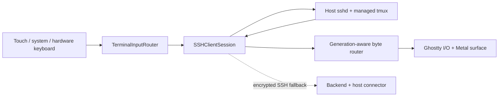

# Architecture

AgenTTY keeps the terminal and its durable shell on opposite sides of SSH.
The phone owns presentation, input, keys and connection recovery; the host owns
shell processes. The optional backend owns routing and service credentials.

## Goals

- Run coding agents such as Claude Code and Codex on your own machines from an
  iPhone or iPad, with sessions that survive suspension, roaming and
  disconnects because tmux on the host owns them.
- Keep OpenSSH's trust model: strict trust on first use, private keys in the
  Keychain, and a relay that carries SSH without terminating it.
- Ship every artifact from one pushed tag with one version: the app,
  TestFlight, the prepared App Store version, the host runtime, the GitHub
  release, the npm pairing package and the backend.
- Build the public repository without private credentials, and let others
  self-host the backend and artifacts.

## Non-goals

- A macOS app. The scaffold was never validated and is gone; Ghostty already
  serves the desktop.
- A staging branch or environment. Dev and Exp are app flavors installed beside
  the main app, not deployment stages.
- Personal or self-hosted runners for this public repository.
- Provider or router credentials in a shipped app.

## App and host

`GhosttyRuntime` owns the emulator and renderer. UIKit owns the Metal surface;
SwiftUI owns chrome, sheets, keyboard composition and settings. Inbound SSH
bytes reach Ghostty on a serial I/O queue; output input is encoded and enqueued
to SSH without blocking visual or haptic feedback. Connection generations
fence obsolete callbacks, and explicit liveness probes detect suspended or
roaming transports. Keyboard presentation and visual depth have single owners.

Saved hosts select a Keychain-backed SSH key. Host trust is TOFU with explicit
mismatch recovery. Automatic pairing transfers a public key and connection
candidates; manual setup and one-time password setup converge on the same saved
host model. Relay fallback wraps the SSH byte stream and retains its encryption
and host verification. Shortcuts background execution opens an exec channel;
foreground execution uses the managed tmux session.

The app downloads checksummed per-platform host binaries and terminfo and
atomically installs them below `~/.agentty`. Scripts/wrappers, runtime integrity
and connection setup share the same provisioning owner. Tmux runs on an
isolated socket so ordinary host tmux installations remain independent.
Agent hooks store bounded turn state for titles and send completion alerts.

## Services and data

The Rust backend owns device/connector authentication, pairing state, APNs,
relay sessions, analytics and transcription quota admission. SQLite is its
durable state boundary, including shared spending and bandwidth reservations.
Signed StoreKit app transactions establish eligibility for hosted features;
notification and dictation credentials have separate purposes. Compatibility
limits cover older clients during rollout. Operators own keys, retention and
ingress. See [backend.md](backend.md) and [PRIVACY.md](../PRIVACY.md) for the
exact data surfaces.

StoreKit access is app-owned: five foreground hours, then a non-consumable
unlock in the official main flavor. Dev/Exp bypass the gate. Analytics use
StoreKit identity only in the main flavor; side-loaded builds without it skip
production events. The outbox separates permanent validation failures from
retryable transport failures.

Dictation capture and insertion belong to the app. SpeechKit supplies provider
transcription and the optional account-fenced private CloudKit library. Archive
publication and terminal insertion have separate outcomes: a successful paste
does not release an original recording. The app bounds its producer spool.

## Decisions

- **Identity through xcconfig.** The public build resolves without private
  credentials while the official app keeps its identities.
  `Config/Defaults.xcconfig` holds the example identity and every setting the
  targets share; ignored `Local.xcconfig` overrides it. The same build settings
  feed Info.plist and entitlements, and `AgenTTYBuildConfiguration` validates
  runtime values once. A parallel runtime settings file or custom parser would
  duplicate Xcode's mechanism. Signed and release commands reject the example
  identity.
- **GhosttyKit as a pinned download.** Ordinary builds fetch the reviewed
  release asset and verify its digest; only explicit vendor maintenance
  rebuilds the source pins. Building Ghostty in CI would add a Zig toolchain and
  minutes to every run, and Git LFS would put a large binary in clones.
- **Cloud signing of one checked export.** The release archives unsigned,
  ad-hoc signs embedded frameworks deepest first and then app bundles, exports
  once through Xcode cloud signing, checks the export's entitlements and every
  framework's Apple Distribution signature, and uploads exactly that IPA with
  `altool`. Exporting again with `destination` `upload` signed a second time and
  shipped bytes nobody checked.
- **One exact upload.** The `numbers` job reserves the build number and the
  serialized TestFlight job uploads with it; GitHub's step history fences a
  rerun after an upload began, so it reuses that build instead of uploading
  again. This replaced a rule against rerunning the upload job. A fresh number
  per retry could send testers a duplicate after a lost acknowledgement.
- **Shared App Store Connect tooling.** `scripts/app-store-connect` and its
  tests are identical to `emileberhard/app-template`'s; AgenTTY's metadata,
  version check and What-to-Test-only TestFlight moved into the template rather
  than living in a fork that drifts.
- **Backend before clients.** `testflight`, `github-release` and `npm` need the
  `backend` deploy, and TestFlight waits until the public `/healthz` reports
  this version or newer, so no client ships before its server. The backend keeps
  compatibility lanes, so installed older apps keep working against it.
- **Release runtimes on GitHub, the latest channel on R2.** A main-flavor app
  reads the host runtime attached to its own tag's GitHub release. Dev, Exp and
  development pairing CLIs read R2's mutable latest channel, so the publisher
  writes only that channel; versioned R2 objects stay for the installed apps
  that compiled their URLs. See the [CI guide](agent-guides/ci-pipeline.md#host-runtime).
- **Screens captured from the app.** `AgenTTY/Sources/iOS/Capture.swift` is a
  Debug-only catalog of `CaptureScreen`s, each rendering the real main window
  from a seeded fixture. The terminal shows a local Claude Code or Codex
  transcript injected through `TerminalBridge` without SSH; the hosts sheet
  opens on any route. The app waits for a stable drawn frame, then
  `AppStore/capture` takes a `simctl` screenshot, which includes Ghostty's Metal
  surface. Light and dark are terminal themes, because the app's color scheme
  follows the theme's luminance. `just ui-previews` renders the catalog into a
  contact sheet; the release captures the App Store screens on fresh simulators
  and `AppStore/compose.swift` frames them with the marketing copy. This
  replaced a Next.js page, Apple bezel downloads, an ascelerate config and a
  launch-argument screenshot mode inside production code, including a fake host
  switcher. The capture build is ad-hoc signed so the Keychain works in the
  simulator. The composer draws each slide's SwiftUI view into its own Core
  Graphics bitmap: on hosted runners `ImageRenderer.cgImage` returned a fully
  transparent image in four of five CI runs, with or without a booted
  simulator, which the composer's opacity check caught.
  A screen that needs a real interaction, such as the open host menu or the
  themes sheet at its large detent, names an accessibility label in its ready
  signal, and the driver taps it with the pinned, checksum-verified AXe CLI,
  then waits for two identical screenshots. On a freshly booted simulator
  AXe's first request always timed out loading Accessibility and the second
  succeeded, so the driver loads it with up to three `describe-ui` calls
  before the first tap. A capture-only XCUITest target could tap too, but it
  adds a second build and test runner to every capture; a production hook
  that opens the menu would fake it. Because Ghostty applies
  the grid resize after a font change asynchronously, the fixture asks the
  terminal for its size (`CSI 18 t`) after each injection and redraws until
  the reply matches the grid it rendered for. The release captures in a
  credential-free `screenshots` job beside `archive`, so App Review waits only
  for the artifact, not for a capture on the critical path.
- **One phone iteration path.** `scripts/iphone-iteration` builds Dev or Exp
  with a reserved build number into a retained checkpoint and installs it on
  the paired iPhone directly, or through SimpleMDM after
  `scripts/prepare-iphone-mdm` removes private inputs from the managed copy. An
  iPad UDID installs directly. It replaced several install recipes, an
  uninstall path and an over-the-air script.
- **Worktree inputs from the main checkout.** `scripts/prepare-local-inputs`
  copies missing ignored inputs such as `Config/Local.xcconfig` from the main
  checkout with mode 0600 and never overwrites. Symlinks would let one
  worktree's edit change every other one.
- **Derived output in `.local/`.** Builds, DerivedData, captures, the host
  runtime and traces live in the checkout's ignored `.local/`, so they leave
  with the worktree, and parallel worktrees never share a build. Xcode's default
  DerivedData outlived deleted worktrees and kept a broken package checkout that
  `-skipPackageUpdates` never repaired; the build now resolves packages again
  when `Package.resolved` changes.
- **Recipes named by intent.** `just` lists grouped recipes, and the Justfile
  exports the `DEVELOPER_DIR` that `scripts/select-xcode` finds for
  `.xcode-version`, so local commands, CI and the release use one Xcode.
- **Swift Testing.** The whole `AgenTTY-iOS-Tests` target uses Swift Testing;
  XCTest remains only where Apple requires it.

Record each later decision here with the alternatives it beat.

## Expensive to change

- The shipped identities: the bundle IDs under `dev.tuist.agentty.*`, the App
  Group, the CloudKit container, the Keychain namespace and the StoreKit
  product. Changing any of them strands installed data or purchases and needs
  an explicit migration.
- The backend's SQLite database, which holds device identities, grants and
  service budgets that installed apps and hosts depend on.
- Published host runtime objects and their URLs, which installed apps compiled
  in, and the npm package name `@agentty-app/pair`.
- Public endpoints compiled into shipped apps.
