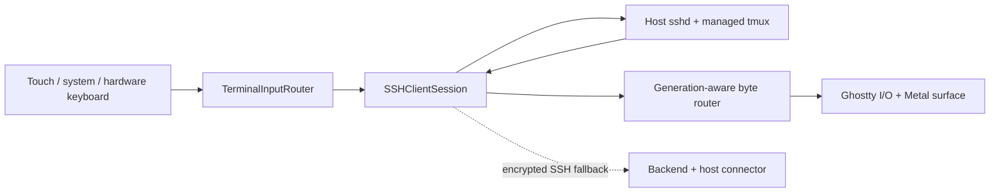

# Architecture

AgenTTY keeps the terminal and its durable shell on opposite sides of SSH.
The phone owns presentation, input, keys and connection recovery; the host owns
shell processes. The optional backend owns routing and service credentials.

## App and host

`GhosttyRuntime` owns the emulator and renderer. UIKit owns the Metal surface;
SwiftUI owns chrome, sheets, keyboard composition and settings. Inbound SSH
bytes reach Ghostty on a serial I/O queue; output input is encoded and enqueued
to SSH without blocking visual or haptic feedback. Connection generations
fence obsolete callbacks, and explicit liveness probes detect suspended or
roaming transports. Keyboard presentation and visual depth have single owners.

Saved hosts select a Keychain-backed SSH key. Host trust is TOFU with explicit
mismatch recovery. Automatic pairing transfers a public key and connection
candidates; manual setup and one-time password setup converge on the same saved
host model. Relay fallback wraps the SSH byte stream and retains its encryption
and host verification. Shortcuts background execution opens an exec channel;
foreground execution uses the managed tmux session.

The app downloads checksummed per-platform host binaries and terminfo and
atomically installs them below `~/.agentty`. Scripts/wrappers, runtime integrity
and connection setup share the same provisioning owner. Tmux runs on an
isolated socket so ordinary host tmux installations remain independent.
Agent hooks store bounded turn state for titles and send completion alerts.

## Services and data

The Rust backend owns device/connector authentication, pairing state, APNs,
relay sessions, analytics and transcription quota admission. SQLite is its
durable state boundary, including shared spending and bandwidth reservations.
Signed StoreKit app transactions establish eligibility for hosted features;
notification and dictation credentials have separate purposes. Compatibility
limits cover older clients during rollout. Operators own deployment, keys,
retention and ingress;
real deployment files are excluded from this tree. See [backend.md](backend.md)
and [PRIVACY.md](../PRIVACY.md) for the exact data surfaces.

StoreKit access is app-owned: five foreground hours, then a non-consumable
unlock in the official main flavor. Dev/Exp bypass the gate. Analytics use
StoreKit identity only in the main flavor; side-loaded builds without it skip
production events. The outbox separates permanent validation failures from
retryable transport failures.

Dictation capture and insertion belong to the app. SpeechKit supplies provider
transcription and the optional account-fenced private CloudKit library. Archive
publication and terminal insertion have separate outcomes: a successful paste
does not release an original recording. The app bounds its producer spool.

## Configuration decision

The public build must resolve without private credentials, while the official
app must retain its bundle IDs, App Group, Keychain namespaces, unlock product,
CloudKit container and public endpoints. `Config/Defaults.xcconfig` supplies
example settings; ignored `Local.xcconfig` overrides them. The same Xcode build
settings feed Info.plist and entitlements; `AgenTTYBuildConfiguration` validates
runtime values once. Signed/release commands reject the example identity.

This uses Xcode's existing configuration mechanism rather than a parallel
runtime settings file or custom parser. Service changes require a new app
build, which is appropriate for signing identity and distribution boundaries.
Changing an official storage identifier later requires an explicit migration;
it cannot be treated as a cosmetic rebrand. Provider keys and host bootstrap
seeds remain separate ignored resources compiled only in Dev/Exp.

## Distribution

Source dependencies and build locks are immutable inputs. Ordinary builds
fetch the reviewed GhosttyKit release asset and verify its digest; explicit
vendor maintenance rebuilds the source pins. Third-party notices accompany the
app, downloadable runtime and npm package, independently of AgenTTY's Shield
license. Public CI never runs on an operator's personal machine.

Hosted cloud signing is attempted only for distribution export of an unsigned
archive. App Groups/CloudKit/extension provisioning must be proved with the
actual Apple account, as the tag releases since 2.12.0 have done. App Store
text and screenshots are committed under `AppStore/` and applied to the version
the tag prepares, which carries the same version as the app, TestFlight, runtime
and npm package.

New main builds resolve their matching host-runtime manifest from the same GitHub release tag. The tag workflow builds tmux and both helpers, packages checksums/notices, and attaches them to the release only after the app archive and runtime pass. The GitHub release with the runtime follows the TestFlight upload. Dev/Exp keep the mutable local artifact channel, and previously shipped immutable static-host URLs remain intact.
